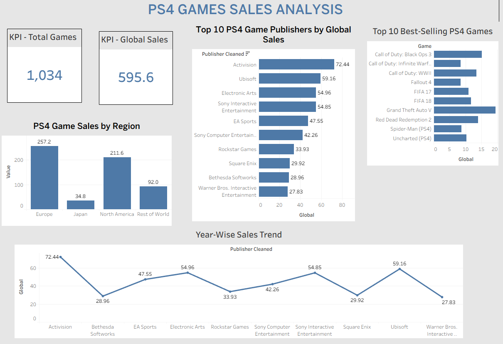

# 🎮 Video Game Sales Analysis | Tableau

### Data Analytics Portfolio Project
**Tableau | Data Visualization | Sales Analysis | Business Intelligence**


---

## 📌 Project Overview

The **Video Game Sales Analysis** project is an interactive data visualization project developed using Tableau.

The objective is to explore video game sales performance across different genres, platforms, publishers, regions, and years.

The project demonstrates how raw sales data can be transformed into meaningful visualizations to support data-driven decision-making.

### Key Areas of Analysis

- Global video game sales performance
- Sales distribution by genre
- Platform-wise sales comparison
- Regional sales performance
- Historical sales trends
- Top-performing games and categories

---

## 📊 Dashboard Preview



**Interactive Dashboard:** Download and open the Tableau workbook below.

[📥 Download Tableau Dashboard](./Video_Game_Sales_Analysis.twbx)

---

## 🎯 Project Objectives

1. Analyze video game sales performance.
2. Identify the highest-performing game genres.
3. Compare sales across gaming platforms.
4. Understand regional sales distribution.
5. Explore sales trends over time.
6. Develop an interactive Tableau dashboard.
7. Present findings through meaningful KPIs and visualizations.

---

## 🛠️ Tools & Technologies

| Tool | Purpose |
|------|---------|
| Tableau | Dashboard development |
| Tableau Calculated Fields | KPI calculations |
| Tableau Filters | Interactive analysis |
| Data Visualization | Charts and comparisons |
| CSV Dataset | Source data |
| Data Cleaning | Data quality and preparation |

---

## 📈 Key Performance Indicators

The dashboard is designed to support sales performance analysis using KPIs such as:

| KPI | Description |
|-----|-------------|
| Total Global Sales | Combined sales across available regions |
| Total Games | Number of game records |
| Total Platforms | Number of distinct gaming platforms |
| Total Genres | Number of distinct game genres |
| Top-Selling Genre | Genre with the highest total sales |
| Top-Selling Platform | Platform with the highest total sales |

**Note:** KPI availability depends on the measures implemented in the final dashboard.

---

## 🧹 Data Cleaning & Preparation

Before developing the dashboard, the dataset was reviewed for quality and consistency.

### Data Quality Checks

- Reviewed missing values.
- Checked data types.
- Examined duplicate records.
- Validated sales-related fields.
- Reviewed categorical values.
- Checked year and regional sales columns.

### Data Preparation

The prepared data was used to create Tableau worksheets, calculated fields, and dashboard visualizations.

---

## 📉 Dashboard Visualizations

### 1. Sales by Genre

**Objective:** Compare total sales across video game genres.

This analysis helps identify categories contributing the most to overall sales.

### 2. Sales by Platform

**Objective:** Analyze sales performance across gaming platforms.

This comparison helps evaluate differences in platform performance.

### 3. Regional Sales Analysis

**Objective:** Understand how video game sales vary across geographical markets.

Regional comparisons can reveal differences in market demand.

### 4. Sales Trend Analysis

**Objective:** Explore how video game sales change over time.

Historical analysis helps identify growth periods, declines, and shifts in market performance.

### 5. Interactive Dashboard Filters

**Objective:** Allow users to explore relevant subsets of the data.

Tableau filters make it easier to compare categories and examine performance from different perspectives.

---

## 🧮 Tableau Calculated Fields

Tableau supports calculated fields for dynamic analysis.

The following are illustrative examples that can be adapted to the dataset.

### Total Global Sales

```tableau
SUM([Global_Sales])
```

### Total Games

```tableau
COUNT([Name])
```

### Total Platforms

```tableau
COUNTD([Platform])
```

### Total Genres

```tableau
COUNTD([Genre])
```

These calculations are examples, not a verified list of the fields used in the published workbook. Field names and calculations should match the actual Tableau data source.

---

## 💡 Business Insights

The dashboard provides a framework for investigating the following business questions.

### Genre Performance

- Which game genres generate the highest sales?
- Are sales concentrated in a small number of genres?
- Which genres may require further analysis?

### Platform Performance

- Which platforms contribute most to total sales?
- How does sales performance differ between platforms?
- Which platforms show stronger historical performance?

### Regional Performance

- How do sales differ across regions?
- Do genre and platform preferences vary geographically?
- Which markets contribute most to overall sales?

### Sales Trends

- How has sales performance changed over time?
- Which years recorded stronger sales?
- What historical patterns are visible in the dataset?

These are analytical questions supported by the project. Specific findings should be added after validating dashboard results.

---

## 📁 Repository Structure

```text
Video-Game-Sales-Analysis-Tableau/
│
├── Video_Game_Sales_Analysis.twbx
├── Video_Game_Sales_Dashboard.png
└── README.md
```

---

## 🚀 How to Use This Project

1. Download the Tableau packaged workbook (`.twbx`).
2. Open it using Tableau Desktop or a compatible Tableau application.
3. Navigate to the completed dashboard.
4. Review the KPI cards and charts.
5. Use available filters to explore the data.
6. Compare sales across genres, platforms, and regions.
7. Interpret the visualizations to identify business insights.

---

## 🎓 Skills Demonstrated

- Tableau Dashboard Development
- Data Visualization
- Data Cleaning and Validation
- Sales Performance Analysis
- KPI Development
- Tableau Calculated Fields
- Interactive Reporting
- Business Intelligence
- Analytical Storytelling

---

## 👨‍💻 About the Author

**Gurudev Mishra**

Aspiring Data Analyst | MIS Reporting | Business Intelligence

**Technical Skills:** SQL, Python, Power BI, Tableau, Advanced Excel

📍 Mumbai, Maharashtra, India

🔗 [GitHub Profile](https://github.com/Gurudevmishra)

🔗 [BlinkIT Excel Project](https://github.com/Gurudevmishra/BlinkIT-Sales-Analysis-Excel)

🔗 [Banking Power BI Project](https://github.com/Gurudevmishra/Banking-Analytics-PowerBI)

---

### ⭐ Turning Data into Insights and Insights into Decisions
